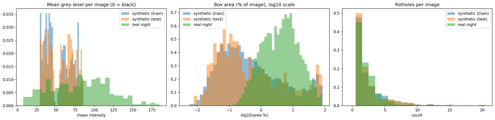
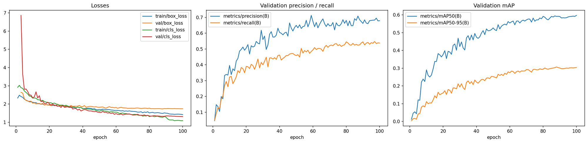
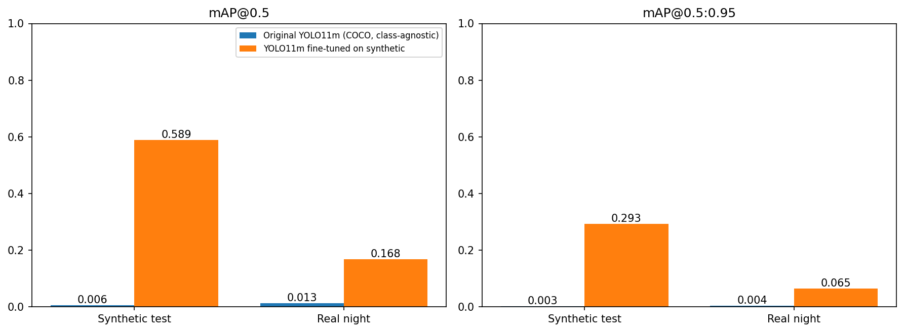
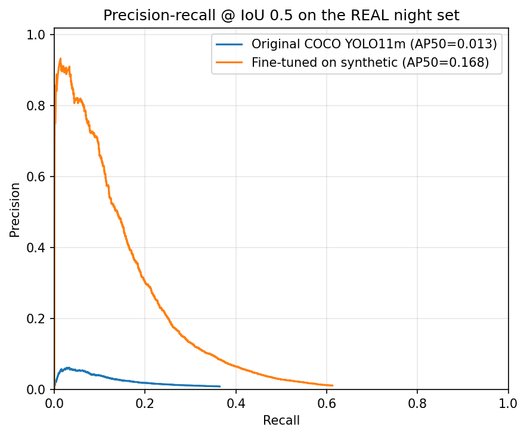
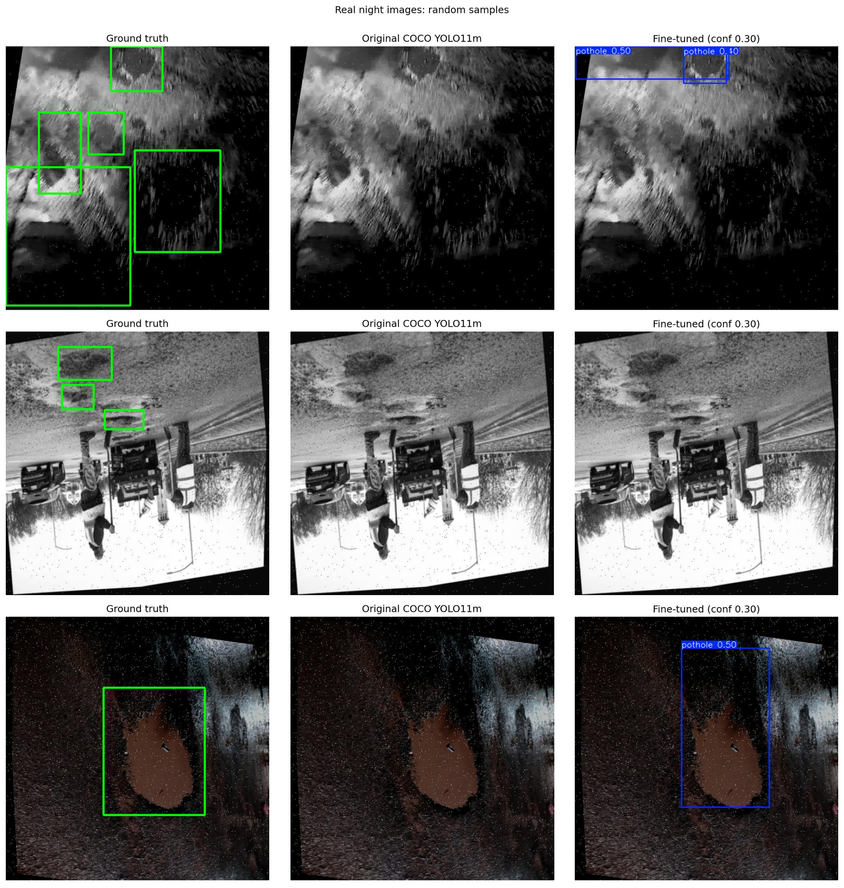

# Nighttime Pothole Detection: YOLO11m, Synthetic Night → Real Night

Detecting potholes in low-light and nighttime road images with **YOLO11m** (Ultralytics). The model is fine-tuned on a pothole dataset with *synthetic* nighttime appearance, then evaluated on a *real* night pothole dataset that is **never used for training or threshold tuning**. The project measures how well synthetic-night training transfers to real night scenes.

> 📄 Full write-up: [`Nighttime_Pothole_Detection_Final_Report.docx`](./Nighttime_Pothole_Detection_Final_Report.docx)
> 📓 Code and experiments: [`ipcv-project-2.ipynb`](./ipcv-project-2.ipynb)

---

## Table of Contents

1. [Highlights](#highlights)
2. [Repository Structure](#repository-structure)
3. [Datasets](#datasets)
4. [Pipeline Overview](#pipeline-overview)
5. [Implementation Details](#implementation-details)
6. [Step-by-Step Instructions](#step-by-step-instructions)
7. [Results](#results)
8. [Limitations](#limitations)
9. [Reproducibility Notes](#reproducibility-notes)
10. [Acknowledgements and Dataset Credits](#acknowledgements-and-dataset-credits)

---

## Highlights

- **Two models compared:** (a) original COCO-pretrained YOLO11m, evaluated *class-agnostically* (it has no pothole class), and (b) YOLO11m fine-tuned on the synthetic night dataset.
- **Strict protocol:** the real night set is used for inference and evaluation only. The confidence threshold (0.30) is chosen on the *synthetic validation* split and reused unchanged everywhere.
- **Two evaluators:** the official Ultralytics `val()` plus a model-agnostic evaluator (greedy IoU matching, 101-point AP) that scores both models identically and gives TP/FP/FN and recall by object size.
- **Main finding:** fine-tuning on synthetic night data clearly beats the COCO baseline on real night images (mAP@0.5 **16.79%** vs **1.29%**), but a large gap to in-domain performance remains (**58.88%** mAP@0.5 on synthetic test).

| | mAP@0.5 | mAP@0.5:0.95 | F1 @ 0.30 |
|---|---|---|---|
| COCO YOLO11m, real night | 1.29% | 0.41% | 2.14% |
| **Fine-tuned YOLO11m, real night** | **16.79%** | **6.50%** | **24.20%** |
| Fine-tuned YOLO11m, synthetic test (in-domain) | 58.88% | 29.30% | 59.03% |

---

## Repository Structure

```
.
├── README.md
├── ipcv-project-2.ipynb                              # Full pipeline: EDA → train → evaluate → figures
├── Nighttime_Pothole_Detection_Final_Report.docx     # Final report with all tables and discussion
└── assets/                                           # Figures used in this README
    ├── synthetic_vs_real_eda.png
    ├── training_curves.png
    ├── model_comparison.png
    ├── pr_curve_real.png
    └── qualitative_real_1.jpg
```

> Datasets and trained weights are **not** stored in this repo (see [Datasets](#datasets)).

---

## Datasets

Both datasets are hosted on Kaggle in YOLO format.

| Role | Dataset | Link |
|---|---|---|
| Training / validation / test (synthetic night) | `phoenixz14/pothole-only` | <https://www.kaggle.com/datasets/phoenixz14/pothole-only> |
| Evaluation only (real night) | `tavishisharma09/night-potholes-yolov8-format` | <https://www.kaggle.com/datasets/tavishisharma09/night-potholes-yolov8-format> |

### 1. Synthetic night dataset (`pothole-only`)

Derived from a three-class dataset (crocodile crack, longitudinal crack, pothole) and converted to a single-class pothole detection set with a synthetic nighttime look:

- Kept images with at least one pothole (including images that also had cracks); removed crack-only images.
- Removed crack annotations; kept only pothole boxes and remapped pothole class ID `2 → 0` (`nc = 1`).
- Created the night appearance by adjusting brightness, contrast and colour only. No geometric transforms, so the boxes stay valid.

| Split | Images | Pothole instances |
|---|---|---|
| Train | 1,876 | 5,149 |
| Validation | 533 | 1,444 |
| Test | 270 | 677 |
| **Total** | **2,679** | **7,270** |

All images are 640 × 640. The integrity check found no unlabeled images, orphan labels, empty labels, corrupt images or out-of-bound coordinates.

### 2. Real night dataset (`night-potholes-yolov8-format`)

A Roboflow night-pothole dataset (via Kaggle). It has only a `train` folder with 1,445 images (640 × 640) and 3,385 boxes in two classes: `0 = night-potholes` (330 boxes) and `1 = pothole` (3,055 boxes).

Preparation in the notebook:

1. Read class names from `data.yaml` and count boxes per class.
2. Visualise four example images per class to decide which class is the pothole.
3. Set `REAL_POTHOLE_CLASS_ID = 1` manually.
4. Keep every image with at least one class-1 box (115 images dropped, **1,330 kept**), keep only class-1 boxes (**3,055**), and remap them to class `0`. The 330 class-0 boxes are dropped.
5. Write a one-class `real_night_data.yaml` whose train/val/test all point to the filtered folder (used for evaluation only).

### Synthetic vs real: dataset analysis



| Set | Images | Boxes | Mean brightness | Median box area (% of image) | Boxes / image |
|---|---|---|---|---|---|
| Synthetic (train) | 1,876 | 5,149 | 53.54 | 0.31% | 2.74 |
| Synthetic (test) | 270 | 677 | 55.59 | 0.23% | 2.51 |
| Real night (filtered) | 1,330 | 3,055 | 81.29 | 4.29% | 2.30 |

The two domains differ mainly in **box size** (real potholes are ~14–19× larger at the median) and **brightness** (real images are brighter on average).

---

## Pipeline Overview

| Step | What happens |
|---|---|
| 0 | Config and helper functions |
| 1 | EDA of the synthetic set (train/val/test) and the real set |
| 2 | Inspect real-set classes, keep pothole only, remap to class 0, compare with synthetic set (brightness, box size) |
| 3 | Fine-tune YOLO11m (COCO-pretrained) on the synthetic set |
| 4 | Evaluate on synthetic val/test (in-domain) |
| 5 | Inference on the real night set with (a) original COCO YOLO11m and (b) the fine-tuned YOLO11m |
| 6 | Comparison table, recall by object size, PR curve, qualitative figures, saved artifacts |

---

## Implementation Details

### Environment

| Item | Value used |
|---|---|
| Framework | Ultralytics YOLO 8.4.191 |
| Python | 3.13.15 |
| PyTorch | 2.11.0+cu128 |
| GPU | NVIDIA Tesla T4 (~14.9 GB), Kaggle notebook |
| Precision | Automatic mixed precision (AMP) on |

### Model

- **YOLO11m** (`yolo11m.pt`), COCO-pretrained. The head is changed from 80 classes to 1; 643 of 649 items were transferred from pretrained weights.
- 231 layers, 20,053,779 parameters, 68.3 GFLOPs (training graph); 125 layers, 20,030,803 parameters, 67.8 GFLOPs after fusing for inference.
- The model is used **unmodified** (no extra attention modules).

### Training configuration

| Setting | Value |
|---|---|
| Data | Synthetic night set; 1,876 train images, 533 val images evaluated each epoch |
| Image size | 800 (source images are 640; 800 helps with the small synthetic potholes) |
| Batch size | 8 |
| Epochs | 100 configured, 100 run (patience 25, early stopping did not trigger) |
| Optimizer | `auto`, resolved to AdamW (lr = 0.002, momentum = 0.9), weight decay 0.0005 |
| LR schedule | Cosine (`cos_lr=True`), 3 warm-up epochs |
| Augmentation | mosaic 1.0 (off for last 10 epochs via `close_mosaic=10`), mixup 0.1, scale 0.5, translate 0.1, fliplr 0.5, flipud 0.0, degrees 0.0, HSV h/s/v = 0.015 / 0.6 / 0.4 |
| Other augmentations | Ultralytics defaults (random erasing 0.4, RandAugment) plus Blur, MedianBlur, ToGray, CLAHE (each p = 0.01) |
| Seed | 42 (Python, NumPy, PyTorch, trainer), `deterministic=True`, 2 workers |
| Training time | ~2.36 h for 100 epochs on a T4 |

Core training call:

```python
model = YOLO("yolo11m.pt")
model.train(
    data="synthetic_data.yaml",
    epochs=100, patience=25, imgsz=800, batch=8,
    optimizer="auto", cos_lr=True, close_mosaic=10, warmup_epochs=3,
    mosaic=1.0, mixup=0.1, scale=0.5, fliplr=0.5, flipud=0.0, degrees=0.0,
    hsv_h=0.015, hsv_s=0.6, hsv_v=0.4,
    seed=42, workers=2, device=0, plots=True,
)
```



### Evaluation protocol

Two evaluation paths are used:

1. **Ultralytics `val()`** (conf 0.001, IoU 0.7, imgsz 800, batch 16): official P, R, mAP@0.5, mAP@0.5:0.95 for the fine-tuned model.
2. **Model-agnostic evaluator** (custom, in the notebook): runs `predict()` (conf 0.001, NMS IoU 0.7), does greedy IoU matching by descending confidence, and computes 101-point AP over IoU 0.50 to 0.95. It scores *any* model, including the COCO model, and also returns TP/FP/FN and recall by size. It was cross-checked against `val()`.

Key conventions:

- **Reference threshold (`CONF_REF` = 0.30):** the confidence that maximises F1 on the *synthetic validation* set (grid 0.01 to 0.99), reused unchanged on every other set.
- **Oracle threshold:** best-F1 threshold on the evaluated set itself, reported for information only.
- **COCO baseline:** class-agnostic. Any detected object, whatever its COCO class, counts as a candidate pothole. This is the most generous reading of that baseline.
- **Recall by size:** at IoU 0.50 and `CONF_REF`, binned by ground-truth box area as a share of the image: small (<1%), medium (1–10%), large (≥10%).

### Key notebook config flags

Set in the config cell (Section 0):

| Flag | Default | Meaning |
|---|---|---|
| `SMOKE_TEST` | `False` | `True` = quick dry run (2 epochs, 5% of data, imgsz 640, 60 eval images) |
| `SYNTH_DIR` / `REAL_DIR` | Kaggle input paths | Dataset roots; change if running outside Kaggle |
| `REAL_POTHOLE_CLASS_ID` | `1` | Pothole class ID in the real set (`None` = auto-detect from `data.yaml`) |
| `IMGSZ` | `800` | Training and inference image size |
| `BATCH` / `EVAL_BATCH` | `8` / `16` | Train / eval batch size |
| `EPOCHS` / `PATIENCE` | `100` / `25` | Training length and early stopping |
| `USE_CLAHE` | `False` | Optional CLAHE on the L channel, applied identically to synthetic and real images |
| `RETRAIN` | `False` | `False` reuses an existing `best.pt` if found |
| `SEED` | `42` | Global seed |

---

## Step-by-Step Instructions

You can run this on **Kaggle (recommended, matches the original setup)** or locally / on another GPU machine.

### Option A: Run on Kaggle (recommended)

1. **Create a Kaggle notebook** and upload `ipcv-project-2.ipynb` (File → Import Notebook).
2. **Add both datasets** via *Add Input* → search and add:
   - `phoenixz14/pothole-only`
   - `tavishisharma09/night-potholes-yolov8-format`
3. **Enable a GPU** (Settings → Accelerator → GPU T4 x1) and turn **Internet on** (needed to `pip install` Ultralytics and download `yolo11m.pt`).
4. **Check the dataset paths.** They should match the notebook:
   ```python
   SYNTH_DIR = Path("/kaggle/input/datasets/phoenixz14/pothole-only")
   REAL_DIR  = Path("/kaggle/input/datasets/tavishisharma09/night-potholes-yolov8-format")
   ```
   If Kaggle mounts them elsewhere, copy the real path from the file browser on the right and update these two lines (and the `DATASET_DIR` lines in the two EDA cells at the top).
5. **(Optional) Smoke test:** set `SMOKE_TEST = True` in the config cell and run all cells to confirm the pipeline works in a few minutes. Set it back to `False` afterwards.
6. **Run all cells** (Run All). The full run takes about 2.4 h of training plus evaluation on a T4.
7. **Collect outputs** from `/kaggle/working`:
   - `runs/yolo11m_synthetic_ft/weights/best.pt` (fine-tuned weights)
   - `results_comparison.csv`, `results_recall_by_size.csv`, `results_summary.json`
   - `figures/` (all plots) and the bundled `report_outputs.zip`
8. **Save your session output** (Save Version → Save & Run All, or download the zip). Files in the runtime may be lost after a session reset.

### Option B: Run locally

1. **Clone the repo**
   ```bash
   git clone https://github.com/<your-username>/<your-repo>.git
   cd <your-repo>
   ```
2. **Create an environment** (Python 3.10+; a CUDA GPU is strongly recommended)
   ```bash
   python -m venv .venv
   source .venv/bin/activate        # Windows: .venv\Scripts\activate
   pip install -U ultralytics jupyter pandas matplotlib opencv-python pyyaml tqdm
   ```
   Install a CUDA build of PyTorch from <https://pytorch.org/get-started/locally/> first if `torch.cuda.is_available()` is `False`.
3. **Download the datasets** from the Kaggle links above (website download, or the Kaggle CLI):
   ```bash
   pip install kaggle      # needs ~/.kaggle/kaggle.json (Kaggle → Settings → Create New Token)
   kaggle datasets download -d phoenixz14/pothole-only --unzip -p data/pothole-only
   kaggle datasets download -d tavishisharma09/night-potholes-yolov8-format --unzip -p data/night-potholes
   ```
4. **Edit the paths** in the notebook:
   ```python
   SYNTH_DIR = Path("data/pothole-only")
   REAL_DIR  = Path("data/night-potholes")
   WORK      = Path("outputs")        # replaces /kaggle/working
   ```
   Each dataset folder should directly contain `train/`, `valid/` (and `test/` for the synthetic set), each with `images/` and `labels/`. The notebook's `find_dataset_root()` searches up to two levels down, so a nested folder is fine.
5. **Remove or skip the Kaggle-only cell** `!pip install -q -U ultralytics` if you've already installed it, and the auto-download `FileLink`/`HTML` snippet in the last cell (it only makes sense in Kaggle).
6. **Launch Jupyter and run**
   ```bash
   jupyter lab ipcv-project-2.ipynb
   ```
   Do a `SMOKE_TEST = True` pass first, then set it to `False` for the full run.

### Using the trained weights for inference on your own images

```python
from ultralytics import YOLO

model = YOLO("runs/yolo11m_synthetic_ft/weights/best.pt")
results = model.predict("your_night_image.jpg", conf=0.30, imgsz=800)
results[0].show()          # or results[0].save("out.jpg")
```

Use `conf=0.30` (the reference threshold from the synthetic validation set) as a starting point.

### What each notebook section does

| Notebook section | Purpose | Main outputs |
|---|---|---|
| EDA cells (top) | Integrity checks and stats for both raw datasets | Per-split counts, class counts, `eda_samples.png` |
| 0. Setup | Install Ultralytics, imports, config, helpers | `device`, folders `runs/`, `figures/` |
| 1. Synthetic dataset | Build `synthetic_data.yaml` | YAML file |
| 2. Real dataset | Class inspection, pothole-only filtering, EDA comparison | `real_night_pothole/`, `real_night_data.yaml`, `real_class_examples.png`, `synthetic_vs_real_eda.png` |
| 3. Fine-tuning | Train YOLO11m, plot curves | `best.pt`, `last.pt`, `training_curves.png` |
| 4. Evaluation tooling | Define custom evaluator and `val()` wrapper | none (function definitions) |
| 5. Synthetic results | `val()` + custom eval on val/test, choose `CONF_REF` | Metric tables, Ultralytics plots |
| 6. Real-night inference | COCO vs fine-tuned on real set; recall by size; PR curve | `model_comparison.png`, `pr_curve_real.png`, comparison tables |
| 7. Qualitative | Ground truth vs COCO vs fine-tuned grids | `qualitative_real.png`, `qualitative_synth.png` |
| 8. Save | CSV/JSON results and zip archives | `results_*.csv/json`, `report_outputs.zip` |

---

## Results

### Fine-tuned YOLO11m on the synthetic dataset

| Metric | Validation (533 imgs) | Test (270 imgs) |
|---|---|---|
| Precision | 64.56% | 71.44% |
| Recall | 55.12% | 51.85% |
| F1 | 59.47% | 60.09% |
| mAP@0.5 | 59.14% | 60.72% |
| mAP@0.5:0.95 | 30.76% | 31.05% |

(Ultralytics `val()`. Model-agnostic evaluator at conf 0.30 gives 58.88% / 29.30% mAP on test.)

### Original COCO vs fine-tuned: master comparison (model-agnostic evaluator)

| Metric | COCO, synth test | Fine-tuned, synth test | COCO, real night | Fine-tuned, real night |
|---|---|---|---|---|
| mAP@0.5 | 0.58% | 58.88% | 1.29% | 16.79% |
| mAP@0.5:0.95 | 0.28% | 29.30% | 0.41% | 6.50% |
| Precision (conf 0.30) | 0.53% | 66.79% | 5.32% | 29.62% |
| Recall (conf 0.30) | 0.15% | 52.88% | 1.34% | 20.46% |
| F1 (conf 0.30) | 0.23% | 59.03% | 2.14% | 24.20% |
| TP / FP / FN | 1 / 188 / 676 | 358 / 178 / 319 | 41 / 729 / 3,014 | 625 / 1,485 / 2,430 |
| Oracle best-F1 threshold | 0.02 | 0.26 | 0.06 | 0.29 |



Cross-check: Ultralytics `val()` on the real set gives the fine-tuned model mAP@0.5 = 19.01%, mAP@0.5:0.95 = 6.99%, P = 30.51%, R = 23.40%.

### Recall by object size (real night, IoU 0.50, conf 0.30)

| Object size (share of image) | GT boxes | Original COCO | Fine-tuned |
|---|---|---|---|
| Small (<1%) | 510 | 0.00% | 14.12% |
| Medium (1–10%) | 1,763 | 0.96% | 18.15% |
| Large (≥10%) | 782 | 3.07% | 29.80% |
| All | 3,055 | 1.34% | 20.46% |

### Precision-recall curve (real night)



### Qualitative examples

Left to right: ground truth (green), original COCO YOLO11m, fine-tuned YOLO11m.



### Key takeaways

- Synthetic-night fine-tuning **improves** real-night detection over the COCO model on every metric.
- Real-night performance remains **far below** the in-domain level (mAP@0.5 drops 42.09 pp).
- The threshold chosen on synthetic validation transfers almost unchanged (oracle F1 on real: 24.40% vs 24.20% at 0.30), so **threshold choice does not explain the gap**.
- Recall rises with object size, so the box-size gap alone does not explain the drop. Brightness, scene, and annotation-style differences are plausible factors (stated as hypotheses in the report, not tested).
- The COCO model mostly fires on cars and people (first 200 real images at conf ≥ 0.25: car 69, person 34, truck 7, motorcycle 5, ...).

---

## Limitations

- Synthetic darkening (brightness/contrast/colour) is not the same as real night capture. Mean brightness is 53.54–55.59 (synthetic) vs 81.29 (real).
- Single training run (seed 42), single evaluation pass: no repeated seeds or confidence intervals.
- Both datasets are filtered to one class; results apply to these prepared datasets only.
- The pothole class in the real set was chosen manually (class 1). A pothole annotated only as class 0 would count as a false positive if detected.
- The real set was not checked for provenance or duplicates; some images appear rotated, flipped, greyscale or daytime.
- The COCO baseline is class-agnostic and uses the 0.30 threshold, so it is a generous but not pothole-trained baseline.
- No real-data fine-tuning was done, so results do not show what training on real night images would achieve.
- Absolute mAP depends on the evaluator (custom evaluator is 0.49–2.22 pp lower than Ultralytics). Model comparisons use one evaluator throughout.

See Section 10 of the report for details.

---

## Reproducibility Notes

- Seeds: `SEED = 42` for Python, NumPy, PyTorch and the Ultralytics trainer; `deterministic=True`. GPU and library version differences can still change numbers slightly.
- Use Ultralytics **8.4.191** to match the reported results exactly: `pip install ultralytics==8.4.191`.
- `RETRAIN = False` reuses an existing `best.pt` in the runs folder. Set `RETRAIN = True` to force retraining.
- Best checkpoint was selected by Ultralytics on validation fitness; the highest validation mAP@0.5 (59.67%) occurred at epoch 100, so curves were still rising slowly at the end of training.
- Kaggle paths (`/kaggle/input`, `/kaggle/working`) only exist on Kaggle. Update them when running elsewhere.

---

## Acknowledgements and Dataset Credits

- Synthetic night pothole dataset: [`phoenixz14/pothole-only`](https://www.kaggle.com/datasets/phoenixz14/pothole-only) on Kaggle (derived from a three-class pothole/crack dataset).
- Real night pothole dataset: [`tavishisharma09/night-potholes-yolov8-format`](https://www.kaggle.com/datasets/tavishisharma09/night-potholes-yolov8-format) on Kaggle (Roboflow night-pothole dataset).
- Please check each dataset's page for its original source and license before redistributing.

## License

Dataset licenses are separate and set by their owners.

## Authors

- Ruchir Tripathi
- Souvik Sarkar
- Tanmay Paul
- Tavishi
<!-- Add your name(s), course (IPCV), institute and contact here. -->
