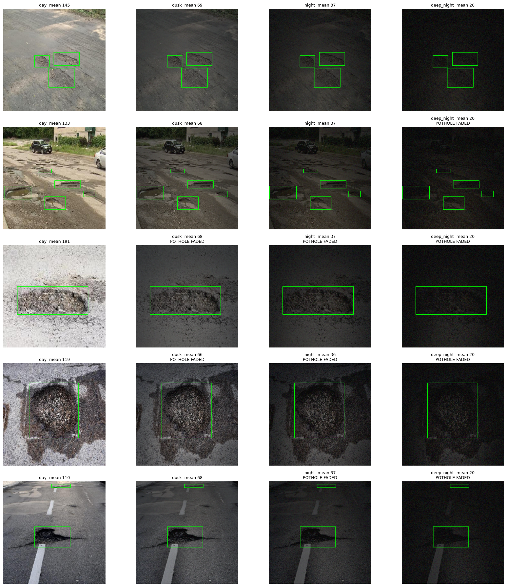
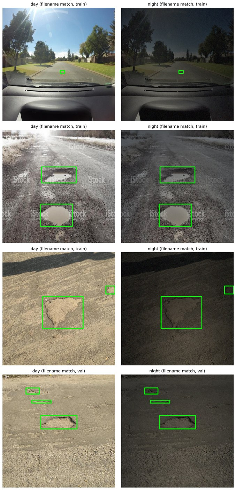
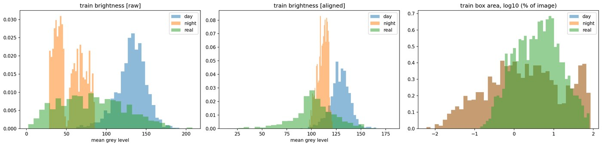
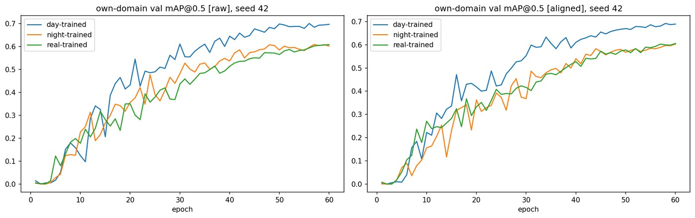
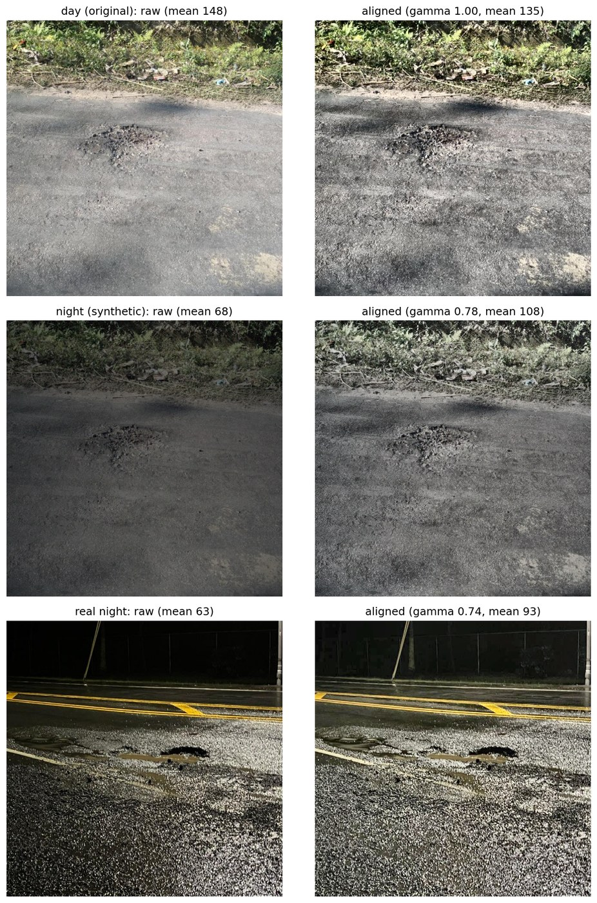
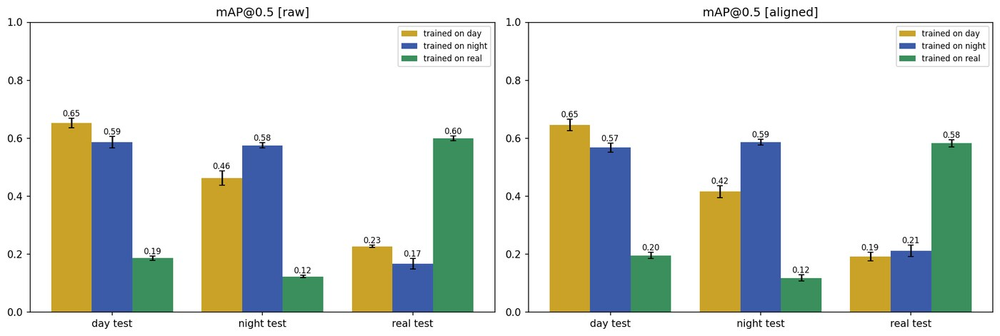
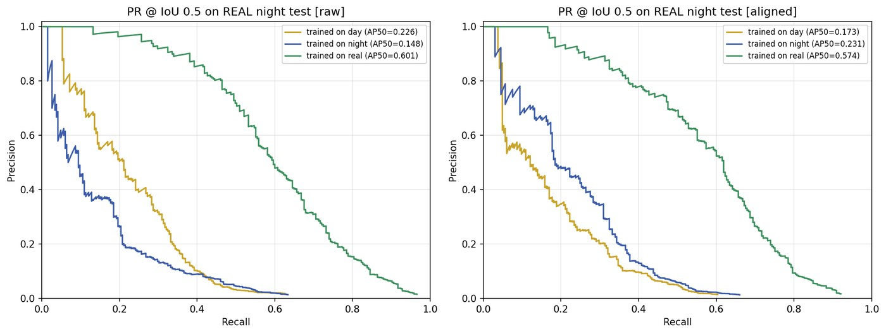
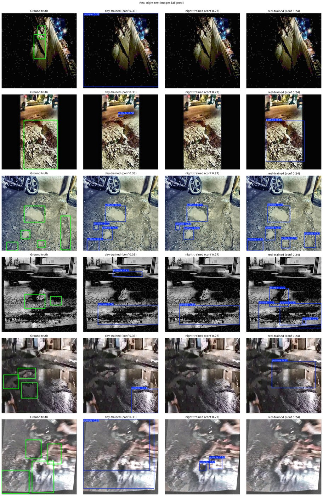

# Nighttime Pothole Detection: Can Synthetic Night Replace Real Night Images?

Detecting potholes in low-light and nighttime road images with **YOLO** (Ultralytics). Real nighttime pothole images are scarce, so the project builds a *synthetic-night* dataset by transforming daytime road images, then asks the key question: **is a day-to-night transformation a successful substitute for real night images when training a pothole detector?**

The repository contains two groups of experiments:

1. **YOLOv8n and YOLOv8s baselines** trained and evaluated on the synthetic-night dataset (original splits).
2. **A controlled YOLO11m transformation test** (`ipcv-project-2-v2.ipynb`): the same detector trained on *day*, *synthetic-night* and *real-night* images of equal size, with and without brightness alignment, three seeds, scored on day, synthetic-night and real-night test sets.

> 📄 Full write-up: [`Nighttime_Pothole_Detection_Combined_Project_Report_Updated.docx`](./Nighttime_Pothole_Detection_Combined_Project_Report_Updated.docx)
> 🎞️ Slides: [`Nighttime_Pothole_Detection_Presentation.pptx`](./Nighttime_Pothole_Detection_Presentation.pptx)
> 📓 Controlled experiment: [`ipcv-project-2-v2.ipynb`](./Source%20Codes/ipcv-project-2-v2.ipynb)

---

## Table of Contents

1. [Highlights](#highlights)
2. [Repository Structure](#repository-structure)
3. [Datasets](#datasets)
4. [Pipeline Overview](#pipeline-overview)
5. [Implementation Details](#implementation-details)
6. [Step-by-Step Instructions](#step-by-step-instructions)
7. [Results](#results)
8. [Limitations](#limitations)
9. [Reproducibility Notes](#reproducibility-notes)
10. [Acknowledgements and Dataset Credits](#acknowledgements-and-dataset-credits)

---

## Highlights

- **Fair, balanced design.** Three YOLO11m detectors (1-class pothole head, COCO-pretrained start) differ only in their training images: **Day** (original), **Night-synthetic** (the same images, darkened) and **Night-real**. Every domain has the same image counts (931 train / 200 val / 114 test), the training sets are size-matched, and all models detect potholes only.
- **Leak-audited.** Day↔night images are paired by filename (boxes must agree at IoU ≥ 0.70) and near-duplicates between splits are removed with a perceptual hash; the real night set has its own grouped 70/15/15 split.
- **Image processing under test.** *Raw* pixels vs *aligned* pixels (per-image gamma lift toward a common brightness, then CLAHE), applied identically to every domain at train and test time.
- **18 models:** 3 training sets × 2 preprocessings × 3 seeds, scored on a 3 × 3 transfer matrix with one custom evaluator.
- **Main finding (honest conclusion).** Synthetic night data **helps**: it gives the best score on synthetic-night test images (0.59 vs 0.42 mAP@0.5 for a day-trained model, aligned). But it **did not replace real night images**: on real night test images the synthetic-night detector reached only **0.17 (raw) / 0.21 (aligned)** mAP@0.5, against **0.60 / 0.58** for a detector trained on real night images — only **28% / 36%** of the real-data level. Its advantage over a day-trained model on real night was not established (-0.061 raw, 95% CI [-0.101, -0.025]; +0.019 aligned, 95% CI [-0.019, 0.051]).

| Test on real night (mAP@0.5, mean of 3 seeds) | Raw | Aligned |
|---|---|---|
| Day-trained | 0.227 | 0.193 |
| Night-synthetic-trained | 0.167 | 0.212 |
| **Night-real-trained (ceiling)** | **0.600** | **0.583** |

---

## Repository Structure

```
D_TEAM_12/
├── README.md
├── Nighttime_Pothole_Detection_Combined_Project_Report_Updated.docx   # Full report (YOLOv8 baselines + controlled YOLO11m test)
├── Nighttime_Pothole_Detection_Presentation.pptx                      # Project presentation
├── assets/                                                            # Figures used in this README
│   ├── alignment_demo.jpg
│   ├── benchmark_balance.jpg
│   ├── day_dusk_night_deepnight.png
│   ├── pairs_day_vs_night.jpg
│   ├── pr_curves_real.jpg
│   ├── qualitative_real.jpg
│   ├── training_curves.jpg
│   └── transfer_matrix.jpg
├── Dataset/
│   ├── Original Dataset/                              # Original daytime 3-class dataset (also the day images of the controlled test)
│   │   ├── data.yaml
│   │   ├── README.dataset.txt
│   │   ├── README.roboflow.txt
│   │   ├── train/  (images/, labels/)
│   │   ├── valid/  (images/, labels/)
│   │   └── test/   (images/, labels/)
│   └── Final Dataset/                                 # Processed single-class pothole dataset, synthetic night (YOLO format)
│       ├── data.yaml
│       ├── train/  (images/, labels/)
│       ├── valid/  (images/, labels/)
│       └── test/   (images/, labels/)
└── Source Codes/
    ├── ipcv-project-2-v2.ipynb                        # Controlled YOLO11m transformation test: pairing → audit → train 18 models → evaluate → figures
    ├── night_sim.ipynb                                # Nighttime simulation / synthetic data generation
    ├── 100_640_nano.ipynb                             # Nano baseline (100 epochs, 640 imgsz)
    ├── 100_640_small.ipynb                            # Small baseline (100 epochs, 640 imgsz)
    └── 100_640_medium.ipynb                           # Medium experiment (100 epochs, 640 imgsz)
```

> Trained weights are **not** stored in this repo. The earlier single-model notebook `ipcv-project-2.ipynb` (a COCO-vs-fine-tuned comparison) has been superseded by `ipcv-project-2-v2.ipynb`.

---

## Datasets

All datasets are hosted on Kaggle in YOLO format.

| Role | Dataset | Link |
|---|---|---|
| Day images (original, 3 classes) | `phoenixz14/daytime-images-3-classes` (IIT Madras pothole dataset) | <https://www.kaggle.com/datasets/phoenixz14/daytime-images-3-classes> |
| Synthetic night (transformed from day) | `phoenixz14/pothole-only` | <https://www.kaggle.com/datasets/phoenixz14/pothole-only> |
| Real night | `tavishisharma09/night-potholes-yolov8-format` | <https://www.kaggle.com/datasets/tavishisharma09/night-potholes-yolov8-format> |

### 1. Synthetic night dataset (`pothole-only`)

Derived from a three-class dataset (crocodile crack, longitudinal crack, pothole) and converted to a single-class pothole detection set with a synthetic nighttime look:

- Kept images with at least one pothole (including images that also had cracks); removed crack-only images.
- Removed crack annotations; kept only pothole boxes and remapped pothole class ID `2 → 0` (`nc = 1`).
- Created the night appearance by adjusting brightness, contrast and colour only (linear light, daylight removal, headlight cone and ambient light, auto-exposure, camera noise, desaturation). No geometric transforms, so the boxes stay valid.

| Split | Images | Pothole instances |
|---|---|---|
| Train | 1,876 | 5,149 |
| Validation | 533 | 1,444 |
| Test | 270 | 677 |
| **Total** | **2,679** | **7,270** |

All images are 640 × 640. The integrity check found no unlabeled images, orphan labels, empty labels, corrupt images or out-of-bound coordinates.



*Figure: Examples of the same road scenes under daytime, dusk, night, and deep-night conditions. Green rectangles indicate the retained pothole annotations.*

### 2. Day originals and day↔night pairing

The original daytime images (`daytime-images-3-classes`) are matched to their synthetic-night versions by filename (Roboflow `_jpg.rf.<hash>` suffix stripped). **1,987 of 2,679 synthetic-night images (74%) were paired**; a pair is kept only if the boxes of the two images agree at IoU ≥ 0.70 so the labels can be shared. A perceptual hash (64-bit dHash, Hamming ≤ 6, mirrored copies included) then removed near-duplicates between splits: **187 of 395 validation and 86 of 200 test images** had a near-duplicate in training and were dropped.



### 3. Real night dataset (`night-potholes-yolov8-format`)

A Roboflow night-pothole dataset (via Kaggle). It has only a `train` folder with 1,445 images (640 × 640) and 3,385 boxes in two classes: `0 = night-potholes` (330 boxes) and `1 = pothole` (3,055 boxes).

Preparation in the notebook:

1. Read class names from `data.yaml` and count boxes per class.
2. Visualise example images per class to decide which class is the pothole; set `REAL_POTHOLE_CLASS_ID = 1`.
3. Keep every image with at least one class-1 box (**1,330 kept**), keep only class-1 boxes (**3,055**), and remap them to class `0`.
4. **Grouped split:** images are grouped by perceptual hash (mirrors included) and whole groups are assigned to train / val / test (70/15/15), so near-duplicates cannot straddle two splits. Real validation is used only to choose the Night-real model's confidence threshold; real test only for final scoring.

### 4. The balanced benchmark

Each domain has identical image counts, and the paired training set is size-stratified to match the real training set's object-size mix.

| Domain | Train / Val / Test images | Train boxes | Median box (% of image, train) | Mean brightness raw → aligned (train) |
|---|---|---|---|---|
| Day | 931 / 200 / 114 | 2,128 | 1.86% | 131 → 129 |
| Night (synthetic) | 931 / 200 / 114 | 2,128 | 1.86% | 55 → 111 |
| Night (real) | 931 / 200 / 114 | 2,156 | 4.13% | 79 → 101 |



Real night potholes are larger and the real images less uniformly dark than the synthetic ones; this is one reason the transformation cannot be expected to be a perfect substitute.

---

## Pipeline Overview

**Baselines (YOLOv8n / YOLOv8s):** synthetic-night dataset → train → evaluate on the synthetic validation and test splits with Ultralytics.

**Controlled test (`ipcv-project-2-v2.ipynb`):**

| Step | What happens |
|---|---|
| 0 | Config, helpers, seeds |
| 1 | EDA of the day, synthetic-night and real-night datasets |
| 2 | Pair day ↔ night images (filename match, content-based fallback), check box agreement |
| 3 | Perceptual-hash leak audit; grouped real-night split |
| 4 | Build the balanced benchmark (equal counts, size-stratified training sets) |
| 5 | Define the *raw* and *aligned* image processing |
| 6 | Train 18 YOLO11m models (3 training sets × 2 preprocessings × 3 seeds) |
| 7 | Custom evaluator: 3 × 3 transfer matrix, thresholds chosen on each model's own validation set |
| 8 | Transformation gain with a paired-bootstrap confidence interval; recall by size; PR curves |
| 9 | Qualitative figures; save CSV/JSON results and a zip of outputs |

---

## Implementation Details

### Environment

| Item | YOLOv8n / YOLOv8s baselines | YOLO11m controlled test |
|---|---|---|
| Framework | Ultralytics 8.4.183 | Ultralytics (use a current release; exact version not recorded in the saved outputs) |
| Python / PyTorch | 3.13.15 / 2.11.0+cu130 | Kaggle default |
| GPU | NVIDIA Tesla T4 | NVIDIA Tesla T4 (Kaggle) |

### Baseline models (YOLOv8)

| Model | Parameters | GFLOPs | Input | Notes |
|---|---|---|---|---|
| YOLOv8n (Nano) | 3.13 M | 8.6 | 640 × 640 | validation 533 images, test 270 images |
| YOLOv8s (Small) | 11.13 M | 28.4 | 640 × 640 | 100-epoch maximum, early stopped at epoch 86, best checkpoint epoch 76, ~55.8 min |

### Controlled-test model and training configuration

- **YOLO11m** (`yolo11m.pt`), COCO-pretrained, head changed to **1 class (pothole)**. The model is used unmodified. Every run uses identical settings; only the training images differ.

| Setting | Value |
|---|---|
| Image size / batch | 640 / 16 |
| Epochs / patience | 60 / 15 (`close_mosaic = 8`, 3 warm-up epochs) |
| Optimizer / schedule | `auto` (AdamW), cosine LR |
| Augmentation | mosaic 1.0, mixup 0.0, scale 0.7, fliplr 0.5, flipud 0.0, degrees 0.0, HSV 0.015 / 0.6 / 0.4 |
| Other | RAM image cache, AMP, `deterministic=True`, 2 workers |
| Seeds | 42, 43, 44 |



### Image processing: raw vs aligned

- **Raw:** pixels as stored.
- **Aligned:** a per-image gamma lift toward a mean grey level of 90 (gamma in [0.4, 1.0]; it never darkens), followed by CLAHE (clip 2.0, 8 × 8 tiles). The same function is applied to **every domain at both train and test time**.



### Evaluation protocol

- **Custom evaluator** (Ultralytics-style 101-point AP): prediction at conf 0.001 / NMS IoU 0.7, greedy IoU matching by descending confidence, mAP@0.5 and mAP@0.5:0.95. Precision, recall and F1 are reported at the confidence that maximises F1 on the model's **own-domain validation set**, so no model uses real night labels unless it was trained on real night.
- **Transformation gain** = Night-synthetic minus Day, tested on real night; 95% CI from a paired bootstrap over test images (300 resamples, averaged over seeds).
- **Ceiling recovered** = (Night-synthetic → real night mAP) / (Night-real → real night mAP).
- **Recall by size** at IoU 0.50, binned by ground-truth box area: small (<1%), medium (1–10%), large (≥10%).

### Key notebook config flags (`ipcv-project-2-v2.ipynb`, config cell)

| Flag | Default | Meaning |
|---|---|---|
| `SMOKE_TEST` | `False` | `True` = quick dry run (2 epochs, 320 px, 1 seed, 40 images per domain) |
| `SYNTH_DIR` / `REAL_DIR` / `DAY_DIR` | Kaggle input paths | Synthetic-night, real-night and original-day dataset roots (**`DAY_DIR` must be set**) |
| `REAL_POTHOLE_CLASS_ID` | `1` | Pothole class ID in the real set |
| `DAY_POTHOLE_CLASS_IDS` | `None` | `None` = keep every box of the day set; else a list such as `[0]` |
| `PREPROCS` | `["raw", "aligned"]` | Image-processing conditions |
| `SEEDS` | `[42, 43, 44]` | Training seeds |
| `TARGET_MEAN` / `GAMMA_MIN` / `CLAHE_CLIP` | `90` / `0.4` / `2.0` | Alignment parameters |
| `HASH_THR` | `6` | Hamming distance for near-duplicates |
| `BOX_IOU_MIN` | `0.70` | Box agreement needed for a day↔night pair |
| `IMGSZ` / `BATCH` / `EPOCHS` / `PATIENCE` | `640` / `16` / `60` / `15` | Training settings |
| `RETRAIN` | `False` | `False` reuses existing `best.pt` files (resume after a session timeout) |
| `TIME_BUDGET_H` | `9.5` | Stop launching new runs after this many hours; re-run the cell to continue |
| `N_BOOT` | `300` | Bootstrap resamples |

---

## Step-by-Step Instructions

You can run this on **Kaggle (recommended)** or locally on a GPU machine.

### Option A: Run on Kaggle

1. **Create a Kaggle notebook** and import `ipcv-project-2-v2.ipynb` (File → Import Notebook).
2. **Add the three datasets** via *Add Input*:
   - `phoenixz14/daytime-images-3-classes`
   - `phoenixz14/pothole-only`
   - `tavishisharma09/night-potholes-yolov8-format`
3. **Enable a GPU** (Settings → Accelerator → GPU T4 x1) and turn **Internet on** (to install Ultralytics and download `yolo11m.pt`).
4. **Set the paths** in the config cell (copy each path from the file browser on the right):
   ```python
   SYNTH_DIR = Path("/kaggle/input/datasets/phoenixz14/pothole-only")
   REAL_DIR  = Path("/kaggle/input/datasets/tavishisharma09/night-potholes-yolov8-format")
   DAY_DIR   = Path("/kaggle/input/datasets/phoenixz14/daytime-images-3-classes")   # set this to your day dataset path
   ```
5. **(Optional) Smoke test:** set `SMOKE_TEST = True` and run all cells to check the pipeline in a few minutes; set it back to `False`.
6. **Run all cells.** Training 18 models is long (several hours on a T4). If the session stops, run the training cell again: finished models are reused (`RETRAIN = False`) and `TIME_BUDGET_H` stops cleanly before the session limit.
7. **Collect outputs** from `/kaggle/working`: `results_long.csv`, `results_claims.csv`, `results_recall_by_size.csv`, `benchmark_balance.csv`, `pairing_summary.csv`, `results_summary.json`, `figures/`, and the weights under `runs/main/`.
8. **Save your session output** (Save Version → Save & Run All, or download the zip). Files in the runtime may be lost after a session reset.

### Option B: Run locally

1. Clone the repo and create an environment (Python 3.10+, CUDA GPU strongly recommended):
   ```bash
   git clone https://github.com/<your-username>/<your-repo>.git
   cd <your-repo>
   python -m venv .venv && source .venv/bin/activate        # Windows: .venv\Scripts\activate
   pip install -U ultralytics jupyter pandas matplotlib opencv-python pyyaml tqdm
   ```
   Install a CUDA build of PyTorch from <https://pytorch.org/get-started/locally/> first if `torch.cuda.is_available()` is `False`.
2. Download the datasets (needs `~/.kaggle/kaggle.json`):
   ```bash
   pip install kaggle
   kaggle datasets download -d phoenixz14/daytime-images-3-classes --unzip -p data/day
   kaggle datasets download -d phoenixz14/pothole-only --unzip -p data/pothole-only
   kaggle datasets download -d tavishisharma09/night-potholes-yolov8-format --unzip -p data/night-potholes
   ```
3. Edit the paths in the config cell:
   ```python
   SYNTH_DIR = Path("data/pothole-only")
   REAL_DIR  = Path("data/night-potholes")
   DAY_DIR   = Path("data/day")
   WORK      = Path("outputs")        # replaces /kaggle/working
   ```
4. Skip the Kaggle-only cells (the `FileLink`/`HTML` download snippet), run `jupyter lab`, do a `SMOKE_TEST = True` pass first, then the full run.

### Using trained weights for inference

```python
from ultralytics import YOLO

model = YOLO("runs/main/<run-name>/weights/best.pt")
results = model.predict("your_night_image.jpg", conf=0.30, imgsz=640)
results[0].show()
```

Use a confidence near 0.30 as a starting point (the validation-chosen thresholds were between 0.24 and 0.34). If you only have synthetic-night data, expect much weaker real-night performance (see Results).

---

## Results

### A. YOLOv8n and YOLOv8s on the synthetic-night test split

| Metric | YOLOv8n | YOLOv8s |
|---|---|---|
| Precision | 67.25% | 68.50% |
| Recall | 53.62% | 54.80% |
| mAP@0.5 | 58.59% | 59.98% |
| mAP@0.5:0.95 | 28.99% | 30.43% |

YOLOv8s led YOLOv8n on all four test metrics, although the differences are modest (Nano slightly led validation). One run per model is not enough to establish statistical superiority. These were scored with the original Ultralytics validation pipeline on the original synthetic splits, which were **not** leak-audited (the audit found nearly half of paired validation/test images had a near-duplicate in training), so absolute scores may be somewhat optimistic and **must not be compared with the controlled-test numbers below**.

### B. Controlled YOLO11m transformation test (mean ± std over 3 seeds, mAP@0.5)

**Raw preprocessing**

| Trained on \ Tested on | Day | Night (synthetic) | Night (real) |
|---|---|---|---|
| Day (original) | 0.652 ± 0.016 | 0.462 ± 0.025 | 0.227 ± 0.004 |
| Night (synthetic) | 0.586 ± 0.020 | 0.576 ± 0.009 | 0.167 ± 0.018 |
| Night (real) | 0.187 ± 0.007 | 0.123 ± 0.004 | 0.600 ± 0.008 |

**Aligned preprocessing**

| Trained on \ Tested on | Day | Night (synthetic) | Night (real) |
|---|---|---|---|
| Day (original) | 0.646 ± 0.020 | 0.416 ± 0.021 | 0.193 ± 0.015 |
| Night (synthetic) | 0.568 ± 0.016 | 0.587 ± 0.010 | 0.212 ± 0.020 |
| Night (real) | 0.196 ± 0.011 | 0.118 ± 0.011 | 0.583 ± 0.013 |



### Does the transformation help, and does it replace real night images?

**Within the synthetic domain, yes.** On synthetic-night test images the night-trained model scores 0.58 (raw) / 0.59 (aligned) versus 0.46 / 0.42 for the day-trained model, at a small cost on day images (0.65 → 0.59 raw, 0.65 → 0.57 aligned).

**On real night images, no.**

| Training set | Raw mAP@0.5 | Aligned mAP@0.5 | Share of real-night ceiling (raw / aligned) |
|---|---|---|---|
| Day (original) | 0.227 ± 0.004 | 0.193 ± 0.015 | 38% / 33% |
| Night (synthetic) | 0.167 ± 0.018 | 0.212 ± 0.020 | 28% / 36% |
| Night (real) = ceiling | 0.600 ± 0.008 | 0.583 ± 0.013 | 100% / 100% |

| Transformation gain on real night (Night-synthetic − Day) | Gain | 95% CI | P(gain > 0) |
|---|---|---|---|
| Raw | -0.061 | [-0.101, -0.025] | 0.00 |
| Aligned | +0.019 | [-0.019, 0.051] | 0.83 |

- With raw pixels the transformed images were significantly **worse** than the original day images for real night testing.
- With aligned pixels the difference becomes a small positive gain, but its interval includes zero, so it is **not established**.
- Alignment itself helped the night-synthetic model on real night (0.167 → 0.212), consistent with part of the synthetic-to-real gap being a brightness mismatch.
- Real-night training reaches 0.58–0.60, about 2.8× the aligned synthetic-night model.



### Recall by object size (real night test, IoU 0.50, aligned)

| Object size (share of image) | GT boxes | Day-trained | Night-synthetic-trained | Night-real-trained |
|---|---|---|---|---|
| Small (<1%) | 46 | 17.4% | 15.2% | 42.8% |
| Medium (1–10%) | 145 | 17.7% | 18.4% | 48.7% |
| Large (≥10%) | 74 | 31.1% | 36.5% | 66.7% |

### Qualitative examples

Real-night test images, left to right: ground truth, day-trained, night-synthetic-trained, real-trained (aligned).



### Key takeaways

- Synthetic night data is **beneficial**: it is the best training choice for synthetic-night test images and alignment improves it on real night.
- It **did not replace real night images**: it recovers only 28–36% of the real-night ceiling.
- Whether the transformation is better than simply using the original day images for real night remains **unproven** (raw: worse; aligned: not significant).
- The result supports using the transformation as a *supplement* (augmentation, pre-training) while still collecting and labelling real night images — not as a replacement.

---

## Limitations

- Synthetic darkening (brightness / contrast / colour / noise) is not real night capture; real night scenes include headlights, wet surfaces, motion blur and different object sizes (median box 4.1% of the image vs 1.9% for day).
- Real-night test set has **114 images** (265 boxes) and three seeds; confidence intervals are bootstrap over test images, not over training sets.
- Only 74% of synthetic-night images could be paired with a day original, and the day, synthetic-night and real-night sets come from different sources.
- The real night set comes from one source folder; its provenance was not independently checked, and the pothole class (class 1) was chosen manually.
- The YOLOv8n/s baselines used the original, un-audited synthetic splits and a single run each; the two experiment groups use different splits and evaluators and are not directly comparable.
- The custom evaluator uses the Ultralytics interpolation convention, which can slightly flatter low-recall models; this applies to all models equally.
- Software versions for the controlled YOLO11m runs were not recorded in the saved outputs.

---

## Reproducibility Notes

- Seeds 42, 43, 44 for training; `deterministic=True`. GPU and library version differences can still change numbers slightly.
- `RETRAIN = False` reuses existing `best.pt` files; set `RETRAIN = True` to force retraining.
- `TIME_BUDGET_H` makes the 18-run training cell restartable.
- The three Kaggle inputs must be present and `DAY_DIR` set; the day dataset is required for pairing.
- Kaggle paths (`/kaggle/input`, `/kaggle/working`) only exist on Kaggle; update them when running elsewhere.

---

## Acknowledgements and Dataset Credits

- Original day dataset: [`phoenixz14/daytime-images-3-classes`](https://www.kaggle.com/datasets/phoenixz14/daytime-images-3-classes) on Kaggle (IIT Madras pothole dataset).
- Synthetic night pothole dataset: [`phoenixz14/pothole-only`](https://www.kaggle.com/datasets/phoenixz14/pothole-only) on Kaggle (derived from the three-class pothole/crack dataset).
- Real night pothole dataset: [`tavishisharma09/night-potholes-yolov8-format`](https://www.kaggle.com/datasets/tavishisharma09/night-potholes-yolov8-format) on Kaggle (Roboflow night-pothole dataset).
- Please check each dataset's page for its original source and license before redistributing.

## License

Dataset licenses are separate and set by their owners.

## Authors

- Ruchir Tripathi
- Souvik Sarkar
- Tanmay Paul
- Tavishi Sharma
